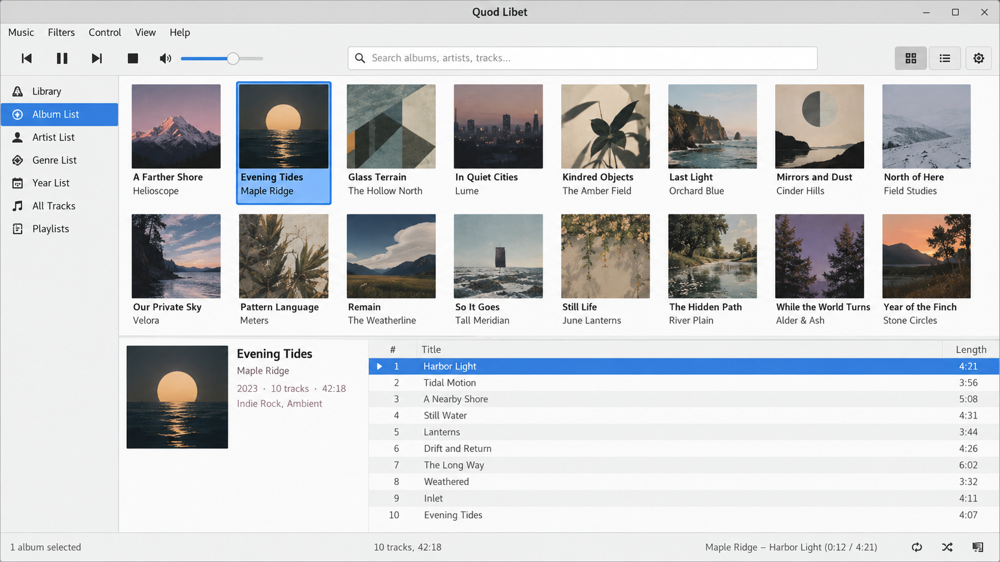
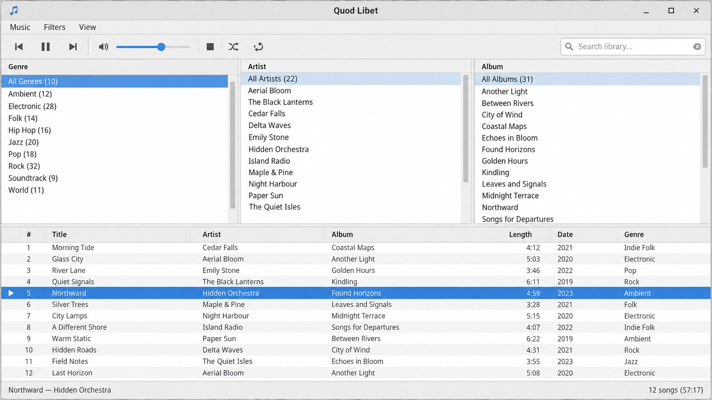
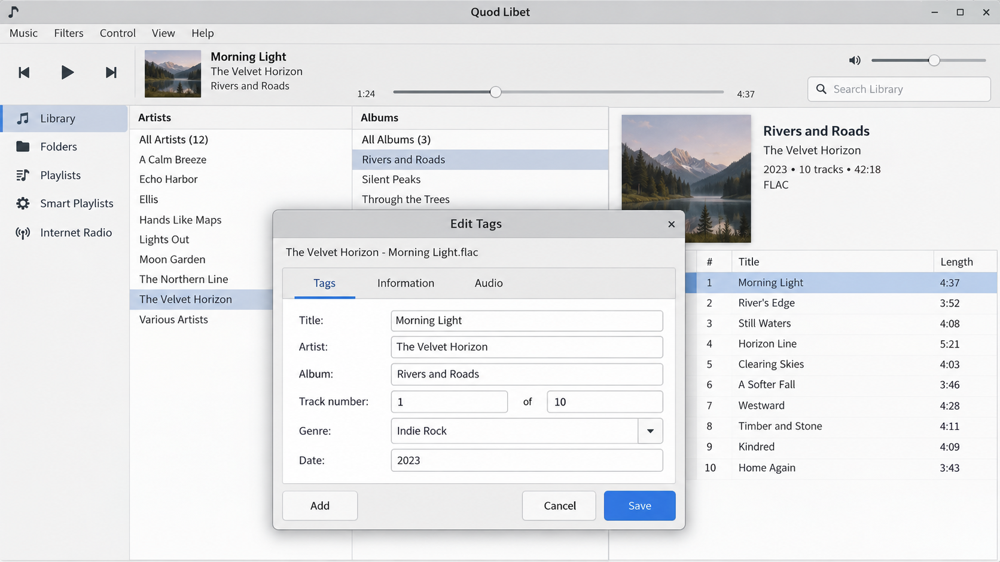

# Quod Libet - Powerful Audio Library Player And Tag Editor

Quod Libet is the primary repository of Quod Libet Music Player, a cross-platform desktop audio player, tag editor, and music library manager written in Python with GTK and GStreamer. Quod Libet Music Player is designed for responsive playback, flexible metadata editing, advanced queries, and collections containing tens of thousands of tracks.

[](https://quod-libet-music-player.github.io/quod-libet/quod-libet)

## Flatpak Packaging For Quod Libet

Quod Libet Flatpak packages provide a sandboxed installation of Quod Libet Music Player. Packaging metadata belongs with the application dependencies defined in [pyproject.toml](pyproject.toml), [requirements.txt](requirements.txt), and [MANIFEST.in](MANIFEST.in).

Detailed platform instructions are maintained in [docs/installation.rst](docs/installation.rst).

### Updating The Python Dependencies

Dependencies for Quod Libet are declared in [pyproject.toml](pyproject.toml) and [requirements.txt](requirements.txt). Update those files together when changing the Python environment, then run the relevant tests before committing generated or dependency-related changes.

## Documents

### Core Documentation

- **[Installation Guide](docs/installation.rst)** - Installing and preparing Quod Libet Music Player.
- **[User Guide](docs/user.rst)** - Using the player, library, browsers, playlists, and controls.
- **[Tag Editing](docs/editing_tags.rst)** - Editing metadata with the Quod Libet tag editor.
- **[Query Guide](docs/query.rst)** - Searching large collections with expressive queries.
- **[Plugin Guide](docs/plugins.rst)** - Extending Quod Libet with optional integrations.
- **[Release Notes](NEWS.rst)** - Changes delivered across Quod Libet releases.

### Project Documentation

- **[Contributing](CONTRIBUTING.md)** - Development and contribution guidance.
- **[Code Of Conduct](CODE_OF_CONDUCT.rst)** - Community participation expectations.
- **[Security](SECURITY.md)** - Reporting and handling security issues.
- **[License](COPYING)** - Licensing terms for the Quod Libet repository.

## Quick Start

### For Plugin Developers

1. Read [docs/plugins.rst](docs/plugins.rst) for the Quod Libet plugin model.
2. Review [src/plugin.py](src/plugin.py) and [src/plugins.py](src/plugins.py).
3. Keep optional behavior isolated from core playback and library operations.
4. Add focused coverage in [tests/test_plugin.py](tests/test_plugin.py).

### For Users

1. Follow [docs/installation.rst](docs/installation.rst).
2. Read [docs/user.rst](docs/user.rst) for library and playback basics.
3. Use [docs/query.rst](docs/query.rst) to build precise searches.
4. Consult [docs/editing_tags.rst](docs/editing_tags.rst) before making large metadata changes.

### For Contributors

1. Review [CONTRIBUTING.md](CONTRIBUTING.md).
2. Install the dependencies declared in [requirements.txt](requirements.txt).
3. Keep changes focused and consistent with [.editorconfig](.editorconfig).
4. Run the relevant tests before submitting a change.

## Key Features



- **Broad Format Support:** Quod Libet Music Player uses GStreamer to play MP3, FLAC, Ogg Vorbis, Opus, AAC, tracker modules, and other formats supported by the active multimedia stack.
- **Advanced Tagging:** The Quod Libet tag editor supports powerful metadata workflows, multiple tag values, batch changes, and query-driven selection.
- **Large Libraries:** The Quod Libet music library manager is designed to search, sort, and browse collections containing tens of thousands of songs.
- **Flexible Queries:** The query system represented by [src/query.py](src/query.py), [src/_query.py](src/_query.py), and [tests/test_query.py](tests/test_query.py) supports precise library filtering.
- **Playback Management:** Playlists, queues, play order, ratings, and remote controls are represented by [src/player.py](src/player.py), [src/playlist.py](src/playlist.py), [src/queue.py](src/queue.py), and [src/remote.py](src/remote.py).
- **Plugin Support:** Quod Libet plugins can extend playback, covers, feeds, metadata, multimedia keys, equalization, and desktop integration.
- **Internet Radio:** The library includes radio support through [src/iradio.py](src/iradio.py).
- **Desktop Integration:** MPRIS support in [src/mpris.py](src/mpris.py) exposes playback metadata and transport controls to compatible desktop environments.
- **Open Source:** Quod Libet is distributed under the terms in [COPYING](COPYING).

### Repository Vocabulary

quod libet, quod libet music player, quod libet audio player, quod libet tag editor, quod libet music library manager, music-player, audio-player, tag-editor, music-library, gstreamer, gtk, python

## Document Organization

### By Audience

**Listeners:**

- [docs/user.rst](docs/user.rst) explains playback and library interaction.
- [docs/query.rst](docs/query.rst) explains collection searches.
- [docs/editing_tags.rst](docs/editing_tags.rst) covers metadata editing.

**Plugin Developers:**

- [docs/plugins.rst](docs/plugins.rst) introduces Quod Libet plugins.
- [src/plugin.py](src/plugin.py) contains plugin infrastructure.
- [tests/test_plugin.py](tests/test_plugin.py) verifies plugin behavior.

**Contributors:**

- [CONTRIBUTING.md](CONTRIBUTING.md) describes the contribution process.
- [SECURITY.md](SECURITY.md) describes security reporting.
- [NEWS.rst](NEWS.rst) records user-visible changes.

### By Topic

**Playback And Audio:**

1. [src/gstplayer.py](src/gstplayer.py) - GStreamer playback.
2. [src/_audio.py](src/_audio.py) - Audio representation.
3. [src/backend.py](src/backend.py) - Backend coordination.
4. [src/equalizer.py](src/equalizer.py) - Equalizer support.

**Library And Metadata:**

1. [src/library.py](src/library.py) - Library management.
2. [src/metadata.py](src/metadata.py) - Metadata operations.
3. [src/edittags.py](src/edittags.py) - Tag-editing interface.
4. [src/tags.py](src/tags.py) - Tag utilities.

**Interface:**

1. [src/quodlibetwindow.py](src/quodlibetwindow.py) - Main Quod Libet window.
2. [src/browser.py](src/browser.py) - Collection browsing.
3. [src/songlist.py](src/songlist.py) - Song-list presentation.
4. [src/ratingwidget.py](src/ratingwidget.py) - Rating interaction.

## Translations

Quod Libet Music Player keeps interface localization separate from playback and metadata logic. Internationalization support is coordinated through [src/i18n.py](src/i18n.py), while user-facing changes should be written so that they remain clear and translatable.

### Testing A Translation From Source

1. Prepare the environment using [docs/installation.rst](docs/installation.rst).
2. Confirm that the interface text starts with clear source-language strings.
3. Run the relevant interface and configuration tests.
4. Restart Quod Libet after changing translation resources because interface text can be loaded during startup.

## Features



Quod Libet combines the library-oriented workflow of a music manager with the direct controls of a desktop player. The interface supports searching, filtering, ratings, cover art, lyrics, bookmarks, playlists, queues, and configurable playback order.

The Quod Libet audio player separates playback, library, and interface responsibilities. GStreamer integration lives in [src/gstelement.py](src/gstelement.py) and [src/gstplayer.py](src/gstplayer.py), while library behavior is handled by [src/library.py](src/library.py) and [src/collection.py](src/collection.py).

## Installation

Binary distribution is represented by the single download button near the top of this README. Source installation requirements and platform-specific guidance are documented in [docs/installation.rst](docs/installation.rst).

### Linux

Quod Libet Linux installations can use native packages or Quod Libet Flatpak distribution. GStreamer plugins installed on the system determine which audio formats and output paths are available.

### Windows

Quod Libet Windows builds provide the same core library, playback, query, playlist, and tag-editing model. Windows-specific filesystem behavior is isolated through modules such as [src/_fsnative.py](src/_fsnative.py).

### Android

This repository targets desktop environments and does not provide an Android application. Mobile clients or remote controllers should interact with supported desktop integrations without assuming direct access to the Quod Libet library files.

## Support And Issue Reporting

Before reporting a problem, read [docs/user.rst](docs/user.rst), check [NEWS.rst](NEWS.rst), and confirm that the issue is reproducible with the current configuration. Security-sensitive reports must follow [SECURITY.md](SECURITY.md).

A useful report identifies the operating system, Python version, GTK environment, GStreamer configuration, affected audio format, and exact steps needed to reproduce the behavior.

## Updating Resources

Quod Libet resources include cover images, interface assets, and metadata artwork. Image handling is implemented through [src/image.py](src/image.py), [src/_image.py](src/_image.py), [src/art.py](src/art.py), and [src/cover.py](src/cover.py).

Resource changes should preserve reasonable dimensions, avoid unnecessary binary growth, and remain usable across supported interface themes.

## Writing Quod Libet Tests

Tests use Python test modules grouped by the behavior they cover. Run the complete suite with:

```bash
pytest
```

Run focused tests while developing a subsystem:

```bash
pytest tests/test_player_gst.py tests/test_library.py tests/test_query.py
```

### Table-Driven Tests

Use parameterized cases when the same behavior must be checked against multiple formats, tags, queries, or configurations. Keep each case small enough that a failure identifies the affected input without additional debugging.

### GTK Widget Tests

Tests that create GTK-facing objects should reuse the project’s established initialization and cleanup behavior. They should not leave windows, playback sessions, temporary libraries, or background operations active after completion.

### Directory Layout And File Naming

Tests use the `test_<subject>.py` naming pattern. Examples include [tests/test_player.py](tests/test_player.py), [tests/test_playlist.py](tests/test_playlist.py), [tests/test_library.py](tests/test_library.py), and [tests/test_qltk_edittags.py](tests/test_qltk_edittags.py).

## Plugin Collection



Quod Libet plugins are enabled through the application’s plugin preferences. The plugin architecture can support browser refresh actions, configurable seeking, tag-aware playback rules, podcast feeds, cover providers, BPM analysis, and metadata synchronization.

### Installation

1. Read [docs/plugins.rst](docs/plugins.rst).
2. Place a compatible plugin in the configured Quod Libet plugin location.
3. Restart Quod Libet Music Player.
4. Open the plugin preferences and enable the plugin.

### Features

**GUI**

- **Browser Extensions:** Plugins can refresh or augment collection views.

**Playback**

- **Playback Rules:** Plugins can alter seeking, skipping, and track selection.
- **Desktop Controls:** MPRIS integration can expose play, pause, previous, next, stop, and metadata updates.

**Podcasting**

- **Audio Feeds:** Plugins can retrieve podcast feeds and combine spoken and musical content.

**Covers**

- **Cover Providers:** Plugins can retrieve and process album or podcast artwork.

**Tags**

- **Metadata Actions:** Plugins can analyze tracks, synchronize ratings, and write calculated values such as BPM.

## Contributing

Contributions to Quod Libet should follow [CONTRIBUTING.md](CONTRIBUTING.md) and [CODE_OF_CONDUCT.rst](CODE_OF_CONDUCT.rst). Keep patches focused, add tests for changed behavior, and update [NEWS.rst](NEWS.rst) when a change affects users.

Formatting and checks are configured through [.editorconfig](.editorconfig), [.pre-commit-config.yaml](.pre-commit-config.yaml), and [pyproject.toml](pyproject.toml).

## Trivia

### What does "quodlibet" mean in music?

“Quodlibet” comes from Latin and means “what you please” or “as you like.” In music, a quodlibet is a composition that combines several familiar melodies, often simultaneously and sometimes with a playful or contrapuntal effect.

The name suits Quod Libet Audio because Quod Libet Music Player emphasizes flexible listening, searching, tagging, and library organization. Users can decide how metadata is displayed, how collections are queried, how songs are ordered, and which Quod Libet plugins extend the application. The Quod Libet repository carries that musical idea into software by supporting many formats and multiple ways to experience one collection.

## Legal

Quod Libet is free, open-source software. The complete license terms are distributed in [COPYING](COPYING).
